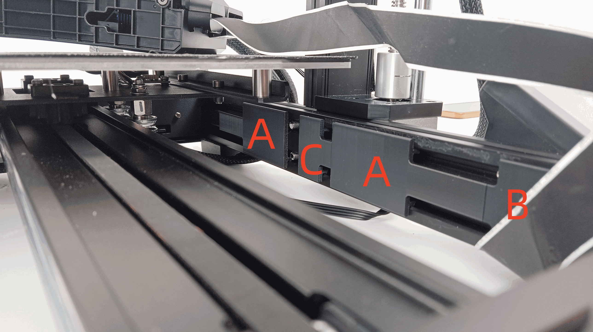

# Printer fix: longboard pads (screen cable spacers)

Updated 2026-11-22 22:12 MST

Four longboard pads (pad A, `Longboard_pads.STL`, twice, plus `Longboard_pads_2.STL` and `Longboard_pads_3.STL`) printed on the SV06 ACE on 2026-11-17 (PLA, 0.20 mm layers, about 1 h 15 min). Sovol suggested this fix, and it was helpful.

## What it fixes
Sovol wiki: [SV06 ACE screen flickers and image is not fully displayed](https://wiki.sovol3d.com/en/SV06-ACE-Troubleshooting/SV06-ACE-screen-flickers-and-image-is-not-fully-displayed) (last edited 2024-12-03).

The screen flickers or shows a partial image because static electricity from the running printer couples into the screen's flat cable where it lies on the metal frame profile. The printed pads hold the cable off the profile. ACAB: All Cables Above Bars 😉

1. Get the STLs (or Sovol's G-code) from [Sovol's Google Drive folder](https://drive.google.com/drive/folders/1yZ5ONajmdrtVkb3aJksB8cJTlVf9wOEm?usp=drive_link) and print them.
2. Remove the three clips that hold the screen flat cable to the profile, without damaging the cable.
3. Fit the pads on the profile in order A, C, A, B (photo below); they can be slid into place afterwards.
4. Put the cable back in the clips and clip them onto the profile over the pads.
5. Check the cable's route so the heated bed cannot hit it when it moves.

*The pads installed on my printer, labelled A, C, A, B from left to right.*

## Files
The STLs are Sovol's and are not in this repo; get them from the Drive folder above. Only my sliced G-code is kept here, locally (`Sovol_SV06_ACE_Longboard_pads_PLA_0.2_1h15m.gcode`); G-code is not published.
